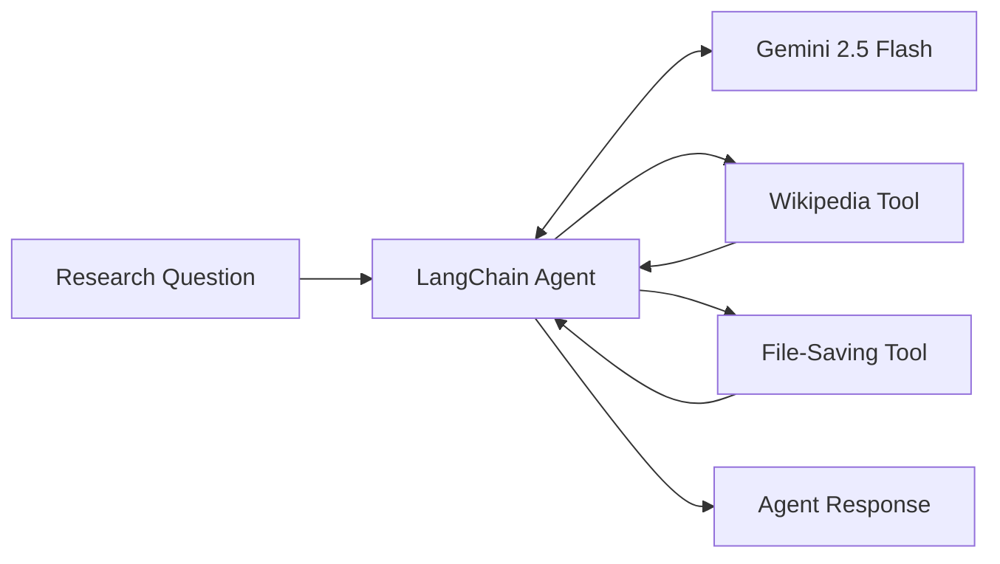

# AI Research Agent with LangChain and Gemini

An experimental command-line research agent built with **Python, LangChain, and Google Gemini**.

The project explores how a large language model can interact with external tools, retrieve information, save research notes, and produce structured responses using a Pydantic schema.

It focuses on agent orchestration, tool calling, and the integration of language models with Python utilities.

> **Project status:** Experimental learning and portfolio project. Some tool integrations and structured-output handling require further improvements.

## Overview

The application accepts a research question through the command line and passes it to a LangChain agent powered by Google Gemini 2.5 Flash.

The agent is configured with tools for Wikipedia lookups and local text-file operations.

A Pydantic schema defines the intended structure of research results, including a topic, summary, sources, and tools used.

The repository also contains a DuckDuckGo search integration, but its current tool registration does not invoke the search implementation correctly.

## Technology Stack

| Technology | Purpose |
|---|---|
| Python | Main programming language |
| LangChain | Agent creation and tool orchestration |
| Google Gemini 2.5 Flash | Language model and tool-calling decisions |
| Wikipedia | External information lookup |
| Pydantic | Structured response schema |
| python-dotenv | Environment variable configuration |
| DuckDuckGo | Search integration included but not currently wired correctly |

The application uses Google Gemini as its active language model.

Additional provider adapters for OpenAI, Anthropic, and DeepSeek are imported, but they are not configured as active models.

## Architecture



The diagram shows the intended main agent workflow. The final structured-response parsing remains subject to the limitations described below.

## Implemented Components

### 1. Gemini-Powered Agent

The project creates a tool-calling agent using LangChain's `create_tool_calling_agent` function.

An `AgentExecutor` manages the interaction between the language model and the registered tools.

The application runs as a command-line program and accepts a user-entered research question.

### 2. Wikipedia Integration

The Wikipedia tool is created using:

- `WikipediaAPIWrapper`
- `WikipediaQueryRun`

The wrapper is configured to return up to three results with a maximum content length of 2,000 characters.

### 3. Local Research Notes

The `save_to_txt` function appends text to a local file.

When invoked, it:

- Creates `research_output.txt` if necessary.
- Appends the supplied content.
- Adds a timestamp in UTC.
- Preserves previously saved entries.

The file is excluded from Git using `.gitignore`.

Saving is tool-driven rather than automatic for every research query.

### 4. Structured Response Schema

The `ResearchResponse` Pydantic model defines four fields:

| Field | Type | Description |
|---|---|---|
| `topic` | `str` | Research topic |
| `summary` | `str` | Summary of findings |
| `sources` | `list[str]` | Reported sources |
| `tools` | `list[str]` | Reported tool names |

A `PydanticOutputParser` is configured to validate model output against this schema.

However, the current response-extraction logic is not reliably compatible with the typical output format of `AgentExecutor`.

## Project Structure

```text
AI_Agent_01/
├── main.py
├── tools.py
├── requirements.txt
├── .env.example
├── .gitignore
├── LICENSE
└── README.md
```

**File responsibilities**

- `main.py` — Initializes Gemini, defines the response schema, creates the agent, and processes command-line input.
- `tools.py` — Configures the Wikipedia integration, local file-saving functions, and search-related components.
- `requirements.txt` — Lists Python dependencies.
- `.env.example` — Shows the API key configuration.
- `.gitignore` — Excludes local environment files and generated output.
- `LICENSE` — Contains a license placeholder rather than a complete license text.

## Getting Started

### Prerequisites

- Python 3.11 or newer, as documented in the original project README
- pip
- A Google Gemini API key
- Internet access for external model and Wikipedia requests

### 1. Clone the Repository

```bash
git clone https://github.com/waistarek/AI_Agent_01.git
cd AI_Agent_01
```

### 2. Create a Virtual Environment

```bash
python -m venv .venv
```

**Windows (Git Bash):**

```bash
source .venv/Scripts/activate
```

**Linux / macOS:**

```bash
source .venv/bin/activate
```

### 3. Install Dependencies

```bash
python -m pip install -r requirements.txt
```

The repository does not pin dependency versions. Compatibility with newer LangChain releases has not been verified.

### 4. Configure Gemini

Create a `.env` file in the project directory:

```env
GOOGLE_API_KEY=YOUR_GOOGLE_API_KEY
```

Replace the placeholder with your own API key.

You can obtain a Gemini API key from [Google AI Studio](https://aistudio.google.com/).

**Security:** Never commit your `.env` file or publish API keys.

### 5. Run the Application

```bash
python main.py
```

The application prompts you to enter a research question.

For example:

```text
Enter your research query: Explain retrieval-augmented generation.
```

The agent then attempts to process the question using Gemini and the registered tools.

The final output may encounter the structured-response parsing limitation described below.

## Known Limitations

This project is an experimental agent implementation, not a production-ready research system.

### DuckDuckGo Tool Registration

A `DuckDuckGoSearchRun` instance is initialized in `tools.py`, but the registered `search_tool` calls `save_to_txt` instead of the search instance.

As a result, the tool named `search_text_to_file` does not perform the intended DuckDuckGo search.

### Tool Descriptions

The `save_text_to_file` tool has a description referring to web search, although its function writes data to a local file.

Accurate descriptions are important for language-model tool selection.

### Structured Output Parsing

The final response-processing code assumes a nested structure containing a `text` field.

However, `AgentExecutor.invoke()` commonly returns its final output as a string.

Consequently, parsing into `ResearchResponse` may fail. The application catches this exception and prints an error together with the raw response.

### Additional Limitations

- No automated test suite is included.
- No graphical user interface is provided.
- No persistent conversation history is configured.
- The application does not independently verify generated research claims.
- Dependency versions are not pinned.
- Alternative language-model providers are imported but not actively configured.
- The repository does not contain a complete license text.
- Successful end-to-end execution has not been verified for this review.

## Learning Objectives

This project explores:

- Building language-model agents with LangChain
- Configuring tool-calling workflows
- Integrating Google Gemini into a Python application
- Connecting an agent to external information sources
- Exposing Python functions as agent tools
- Defining structured outputs with Pydantic
- Managing API credentials through environment variables

## Project Scope

AI_Agent_01 is a learning-oriented implementation of an AI research assistant.

Its primary purpose is to explore the architecture and practical challenges of tool-using language-model agents.

The repository also illustrates the importance of correct tool registration, structured-response handling, and dependency management when developing agent-based applications.
